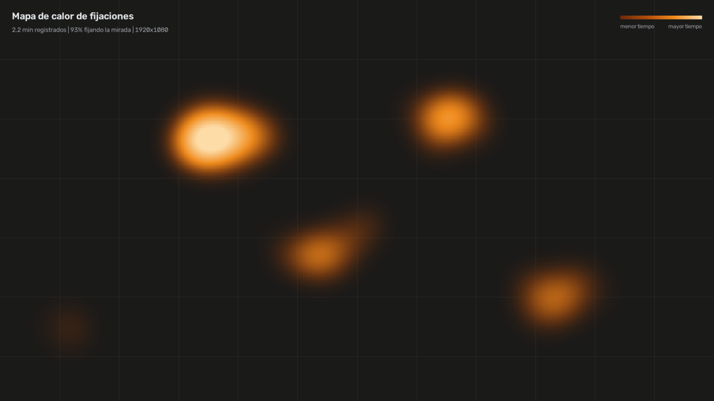

# Gaze Tracker & Attention Monitor

[Español](README.md) · **English**

Webcam gaze tracking, **100 % local and CPU-only**. It estimates where you are looking on the
screen, warns you after more than 3 seconds looking away, and on exit generates a heatmap of your
fixations. No frame is ever written to disk or leaves the computer.



## Install and run

```powershell
python -m venv .venv
.venv\Scripts\activate
pip install -r requirements.txt
python -m gaze_tracker
```

First run shows a ~90-second click-free calibration: follow a circle with your head still, then
moving it slowly, then look at 9 + 5 fixed points. **Fixed points are never used for training — they
measure the real error.**

## How it works

```
QThread GazeWorker                                 Main thread (Qt)
camera → landmarks → head pose → 3D gaze ray      ── signals only ──▶ move dot
       → Ridge + kernel corrector → One Euro → attention → heatmap
```

| Layer | Technique | Learns from |
|---|---|---|
| Face & iris landmarks | MediaPipe neural networks | Pre-trained by Google |
| Personal geometry | Regularized optimization (eye radius/depth, focal, face scale) | Your calibration |
| Screen mapping | Ridge regression + RBF kernel on the residual | Your calibration |
| Smoothing | One Euro filter | — |

- **Pose invariance:** `solvePnP` gives the head pose; the camera–iris ray is intersected with the
  eyeball to obtain a 3D gaze vector, so Ridge only learns plane → screen.
- **Why Ridge, not SVR:** an RBF-SVR regresses to the mean outside the training data — with the real
  gaze at 1.25 screen widths, Ridge flagged "off-screen" 100 % of the time, SVR 0 %.
- **Lag estimation** with a single pseudo-inverse over all candidate delays.
- **Honest validation:** accuracy (bias) and precision (jitter) reported separately on held-out points.

## Measured results (simulation)

| Scenario (median error, 1920×1080) | Classic iris–corners | 3D geometry |
|---|---:|---:|
| Calibration pose | 49 px | 45 px |
| 20° head yaw | 532 px | 87 px |
| Combined movement | 593 px | 167 px |

Personal calibration cut moved-head error from 100–245 px to 17–37 px. CPU: ~25 % of one core
while tracking at 15 FPS (~3 % on an 8-thread machine); 2.8 % with no face present. MediaPipe takes
~14 ms per frame; geometry ~0.3 ms; Ridge + corrector ~66 µs.

First real data (one person, three sessions) showed excellent horizontal tracking (R² 0.97–0.98) but
weak vertical tracking, which motivated v0.4's eyelid and vertical-signal layers (R² 0.98–0.99 in
simulation of the measured symptom).

## Limitations

Not yet validated with multiple real users; 640×480 resolution limits precision to screen *zones*, not
words; extreme poses roughly double the error; single monitor.

## Tests

```bash
pip install pytest scikit-image
pytest tests   # 86 tests; UI tested with real threads and headless Qt
```

---
Personal portfolio project by **Johan Esteban García Bautista** · MIT License
