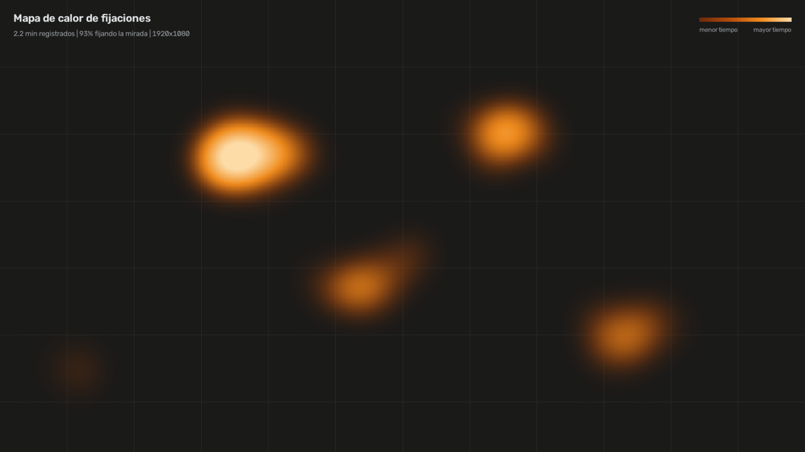

# Gaze Tracker & Attention Monitor

**Español** · [English](README.en.md)

  

Seguimiento de mirada con webcam, 100 % local y en CPU. Estima hacia dónde miras
en la pantalla, avisa si llevas más de 3 segundos fuera de ella y, al salir,
genera un mapa de calor de tus fijaciones.

Ningún frame se escribe en disco ni sale del equipo. La única conexión es la
descarga inicial del modelo de MediaPipe (3.7 MB).



*Imagen de ejemplo generada con datos sintéticos.*

## Instalación y uso

Requiere Python 3.10 o superior y una webcam.

```powershell
python -m venv .venv
.venv\Scripts\activate
pip install -r requirements.txt
python -m gaze_tracker
```

La primera vez aparece la calibración, de unos 90 segundos y sin clics:

1. Sigues el círculo con la cabeza quieta (30 s).
2. Lo sigues moviendo la cabeza despacio (35 s).
3. Miras 9 puntos fijos desde tu postura normal.
4. Cambias de postura y miras otros 5 puntos.

Los puntos fijos no se usan para entrenar: miden el error real. Al terminar verás
el resultado en pantalla y lo decides con Enter (continuar) o R (repetir). La
calibración se guarda en `~/.gaze_tracker/calibration.npz`, y las siguientes
sesiones arrancan directo.

| Acción | Cómo |
| --- | --- |
| Mostrar u ocultar el indicador | `Ctrl+Shift+H` |
| Recalibrar | Menú de la bandeja, o `--recalibrate` |
| Medir el error sin recalibrar | Menú de la bandeja, o `--validate` |
| Cancelar la calibración | `Esc` |
| Salir y generar el mapa | Menú de la bandeja, o `Ctrl+C` en la consola |
| Bajar el consumo | `--fps 10` |
| Elegir cámara o usar un video | `--camera 1`, `--camera video.mp4` |

Los mapas se guardan en `~/Pictures/GazeTracker`.

## Arquitectura

```
gaze_tracker/
├── config.py        Parámetros inmutables
├── capture.py       Cámara con límite de FPS + FaceLandmarker
├── geometry.py  ★   Iris, solvePnP y rayo de mirada 3D
├── model.py     ★   Ridge, corrector kernel, latencia y filtro One Euro
├── pipeline.py      Inferencia por frame, sin Qt
├── attention.py     Regla de los 3 s con antirrebote
├── personal.py  ★   Ajuste de ojo, focal y rostro; elige el mejor modelo
├── validation.py    Exactitud y precisión con puntos fijos; historial
├── display.py       Tamaño físico del monitor desde el EDID
├── heatmap.py       Acumulación O(1) y PNG final
├── trajectory.py    Curvas de calibración con cobertura garantizada
├── calibration.py   Ventana a pantalla completa
├── worker.py    ★   QThread de captura e inferencia
├── hotkey.py        Atajo global con RegisterHotKey
├── ui.py        ★   Overlays, bandeja y orquestación
└── __main__.py      Punto de entrada
tools/simulate.py    Banco sintético con verdad geométrica conocida
tools/replay.py      Repite el ajuste con la última sesión, sin calibrar
tests/               Pruebas unitarias, de UI y de integración
```

```
QThread GazeWorker                          Hilo principal (Qt)
cámara → landmarks → pose → rayo → Ridge    ── solo señales ──▶  mover punto
       → One Euro → atención → heatmap      ── al cambiar ───▶   mostrar/ocultar marco
```

## Machine learning

| Capa | Técnica | Dónde aprende |
| --- | --- | --- |
| Puntos del rostro e iris | Redes neuronales de MediaPipe | Preentrenadas por Google |
| Geometría personal | Optimización regularizada | Tu calibración |
| Mapeo a la pantalla | Ridge polinómico, con párpados si mejora | Tu calibración |
| Corrector de sesgos | Regresión kernel RBF sobre el residuo | Tu calibración, si mejora la validación |

**Por qué este modelo.** Se comparó en simulación con sesgos no lineales del detector y error
de seguimiento. Valores en píxeles con sesgo de forma no polinómica; "fuera" es la detección
de una mirada a 1.25 pantallas.

| Modelo | Cabeza movida | Fuera |
| --- | ---: | ---: |
| Ridge solo | 119 | 100 % |
| Ridge + kernel RBF | 54 | 100 % |
| Ridge + polinomio grado 3 | 47 | 100 % |

Una red MLP (32-64 neuronas) y el boosting quedaron por detrás en una comparación aparte, con
sesgo polinómico: 43-58 px y 31-33 px frente a 17-24 px de los mejores. La SVR no detectó ninguna
mirada fuera de pantalla. El grado 3 empeoró con la cabeza girada 30° (257 px frente a 184 px)
y el kernel no (200 px); con sesgo polinómico gana el grado 3, pero esa forma lo favorece.
Hay pocos datos (~1 300 muestras muy correlacionadas), y eso penaliza a los modelos flexibles.

El kernel se aplica al residuo porque, lejos de los datos, su corrección tiende a cero: Ridge
sigue extrapolando y la alerta fuera de pantalla se conserva. Solo se activa si reduce al menos
un 5 % el error en los puntos fijos. Agrega ~66 µs por frame y unos segundos al ajuste, y se guarda en
`.npz`, sin pickle.

## Decisiones técnicas

**Invarianza a la pose.** Ridge no recibe el iris en píxeles. `solvePnP` da la
pose de la cabeza; con ella se ubica el centro del ojo en 3D, el rayo cámara-iris
se intersecta con el globo ocular y se obtiene el vector de mirada. El punto donde
ese vector corta el plano de la cámara (en mm) ya descuenta rotación y traslación.
Ridge solo aprende la relación entre ese plano y la pantalla.

**Sincronización de la calibración.** La mirada va retrasada respecto al círculo y
la cámara añade latencia. `estimate_lag` prueba todos los retrasos de una vez: una
sola pseudoinversa evalúa la matriz de objetivos completa, sin bucle de ajustes.

**Ridge en lugar de SVR.** Una SVR-RBF regresa a la media fuera de los datos de
entrenamiento. Con la mirada real a 1.25 anchos de pantalla, en el banco sintético,
Ridge la marcó como fuera de pantalla en el 100 % de los casos y SVR en el 0 %.

**Calibración personal.** El error al mover la cabeza viene sobre todo de una geometría
equivocada, no del regresor. La fase con cabeza en movimiento permite estimar el radio y
la profundidad del ojo, la focal y la escala del rostro: rejilla en la focal, Powell
acotado en el resto y un prior anatómico. Calibrar moviendo la cabeza no ayuda sin este
ajuste; lo que aporta es la información para hacerlo.

**Validación honesta.** Los puntos fijos no entran al ajuste de ninguno de los modelos.
Se separan exactitud (sesgo) y precisión (temblor). El modelo personal solo se adopta si
supera al genérico en esos puntos y si la cabeza se movió lo suficiente; la selección usa
los mismos puntos que se reportan, así que el resultado puede ser levemente optimista.
Cada sesión queda en `validation_history.jsonl`, sin imágenes.

**Consumo.** El indicador es una ventana de 26 px que solo se mueve; el marco rojo
se pinta una vez. Sin rostro, la captura baja a 5 FPS. La inferencia corre en el
hilo de fondo y la UI solo recibe señales. El atajo usa `RegisterHotKey`, sin hooks
de teclado: el programa nunca observa otras teclas.

**`FaceLandmarker` en lugar de `FaceMesh`.** Las versiones actuales de MediaPipe ya
no incluyen `mp.solutions.face_mesh`; se usa la API Tasks, con los mismos 478 puntos.

## Resultados medidos

### Precisión con la cabeza en movimiento (simulación)

`python tools/simulate.py`. Error mediano en una pantalla de 1920×1080 tras una sola
calibración. El simulador usa parámetros de ojo, focal, escala facial, inclinación de
pantalla y ángulo kappa distintos a los que asume el estimador, con ruido de 0.25 px.

| Escenario | Iris-comisuras (clásico) | Geometría 3D |
| --- | ---: | ---: |
| Pose de calibración | 49 px | 45 px |
| 100 mm a un lado | 224 px | 72 px |
| 60 mm abajo | 137 px | 56 px |
| 150 mm más cerca | 209 px | 46 px |
| 200 mm más lejos | 191 px | 86 px |
| Giro de 20° (yaw) | 532 px | 87 px |
| Inclinación de 12° (pitch) | 289 px | 74 px |
| Combinado | 593 px | 167 px |

Estas cifras muestran la mejora relativa, no la precisión que tendrás con una persona
real: la simulación no incluye sesgos del detector de iris, gafas, luz ni el seguimiento
imperfecto del círculo.

### Calibración personal (simulación)

Puntos fijos fuera del ajuste, con ojos y cámaras distintos a los valores por defecto.
Los valores son medianas por punto de ocho corridas con cuatro perfiles.

| Validación | Genérico | Personal |
| --- | ---: | ---: |
| Postura normal | 10-49 px | 12-59 px |
| Cabeza movida | 100-245 px | 17-37 px |

En poses no usadas para ajustar, el caso combinado bajó de ~160 px a 50-90 px con ruido de
0.25 px. Alejarse 200 mm casi no mejora (~85 px → ~80 px): la escala facial es el parámetro
peor identificado.

### Sistema final (simulación)

Medias de seis corridas con selección automática, sesgo no lineal y error de seguimiento. Cada
celda compara el modelo sin corrector con el modelo final.

| Sesgo simulado | Activado | Cabeza movida | Pose nueva |
| --- | ---: | ---: | ---: |
| Ninguno | 1/6 | 20 → 19 px | 65 → 65 px |
| Polinómico | 6/6 | 38 → 26 px | 95 → 84 px |
| No polinómico | 6/6 | 116 → 61 px | 136 → 121 px |
| No polinómico fuerte | 6/6 | 215 → 77 px | 248 → 168 px |

Con la cabeza girada 30°, una pose fuera del rango de calibración, la corrección no ayuda de forma
fiable: osciló entre 5 px mejor y 14 px peor. Los sesgos simulados son supuestos; su forma real se
conocerá con datos de personas.

### Costo de CPU (modelo real)

Medido en una VM Linux de 2 vCPU, con video MJPEG de 640×480 y sin el costo de Qt ni del
driver de cámara.

| Modo | FPS | CPU de un núcleo | Equivalente en 8 hilos* |
| --- | ---: | ---: | ---: |
| Sin rostro | 5 | 2.8 % | ~0.4 % |
| Seguimiento | 15 | 25 % | ~3 % |
| Calibración | 20 | 33 % | ~4 % |

\* Extrapolación aritmética suponiendo núcleos de velocidad similar. Hay que confirmarla
en el Administrador de tareas de cada equipo. Con 4 hilos, el seguimiento rondaría el 6 %.

Dentro de cada frame, MediaPipe toma ~14 ms; `solvePnP` y la geometría, ~0.3 ms; Ridge más el corrector, ~66 µs.

### Primeros datos reales (una persona, Windows, 1920×1080)

Tres sesiones con la versión 0.3. La mirada horizontal fue muy buena (R² 0.97-0.98), pero la
vertical no (R² 0.39-0.85, pendiente 0.33-0.71), con hasta 523 px de error en la zona baja. El
temblor fue de 19-27 px, así que el error era sistemático. Esto motivó la versión 0.4.

### Señal vertical (simulación del síntoma medido)

Sesgo que frena el descenso aparente del iris, ajustado para reproducir una pendiente de 0.38-0.46.
Es una hipótesis de causa; el efecto real se conocerá con la siguiente calibración.

| Métrica | Sin párpados ni capas | Sistema completo |
| --- | ---: | ---: |
| Exactitud | 236-292 px | 36-40 px |
| R² vertical | 0.28-0.37 | 0.98-0.99 |
| Pendiente vertical | 0.38-0.46 | 0.87-0.89 |

## Detección automática

- **Monitor:** se lee el EDID del registro de Windows. Si no está disponible, el ancho se estima
  desde el mapeo aprendido y se muestra como "estimado".
- **Distancia:** sale de la pose de la cabeza. Depende de la focal, que una webcam no informa. En
  simulación, con el sesgo vertical presente, llegó a errar ~30 % (43 cm frente a ~62 cm reales), así
  que los grados son aproximados y conviene comparar en píxeles.

## Datos locales

Todo queda en `~/.gaze_tracker`. `last_session.npz` guarda las coordenadas de los landmarks de la
última calibración, nunca imágenes, para repetir el análisis con `tools/replay.py`. Se sobrescribe en
cada calibración y se puede borrar sin afectar el funcionamiento.

## Limitaciones

- **Sin validación con personas reales todavía.** El pipeline se probó con MediaPipe real
  sobre un video generado desde una imagen de un rostro, pero no con alguien siguiendo el
  círculo. La pantalla de resultados dará la primera medición real.
- **La resolución limita la precisión.** Con 640×480 a 60 cm, el iris mide unos 11 px, y
  1 px de error en el iris equivale a ~5.7°, unos 200 px en un monitor de 24". Sirve para
  saber en qué zona miras, no para detectar palabras. `frame_width` y `frame_height` en
  `config.py` permiten subir la resolución a costa de CPU.
- **Mirada hacia arriba:** con un sesgo vertical más fuerte que el medido, la mirada por encima de la
  pantalla dejó de detectarse en la simulación.
- **Selección con pocos puntos:** cada capa se elige con los mismos 14 puntos que se reportan; con
  varias opciones, el resultado puede salir algo optimista.
- **Pose extrema.** En la simulación, el caso combinado casi duplica el error.
- **Un solo monitor:** trabaja sobre la pantalla principal.
- **Windows:** la lectura del EDID solo se ha probado con simulaciones del sistema; la app ya corrió
  en Windows, pero esa parte es nueva.

## Pruebas

```bash
pip install pytest scikit-image
pytest tests
```

87 pruebas, en Python 3.10 (MediaPipe 1.2.2) y 3.13 (MediaPipe 0.10.32). La UI se prueba
con hilos reales y Qt sin pantalla. La integración con MediaPipe se omite si el modelo
aún no está descargado.
